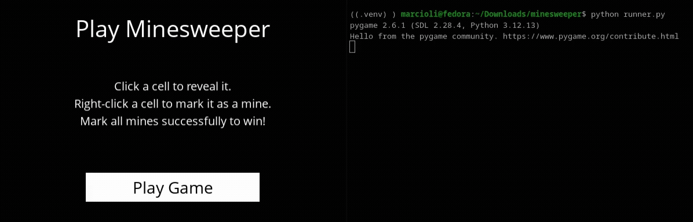

# 💣 Minesweeper AI — Knowledge-Based Propositional Logic Agent


A knowledge-based AI agent capable of solving Minesweeper through **propositional logic, knowledge representation, and recursive logical inference**.

Developed as part of **Harvard's CS50's Introduction to Artificial Intelligence with Python course**.

## 📸 Demo


## 💡 About the Project
Unlike classic game-playing algorithms like Minimax (which search through game trees), Minesweeper is a game of imperfect information. The agent cannot see the entire board at once and must deduce safe cells and mine locations purely through **logical inference based on local knowledge**.

This project implements a **Knowledge-Based Agent** that represents logical statements about the board as mathematical set equations. As new cells are revealed, the AI updates its Knowledge Base (KB) and recursively infers new facts using subset relations, guaranteeing $100\%$ mathematical certainty on safe moves whenever logical deductions are possible.

### Key Highlights:
- Propositional Knowledge Representation: Board constraints are modeled as Sentence(cells, count) objects, representing equations where a set of cells contains an exact number of mines.
- Subset Inference Engine: Automatically derives new logical constraints by subtracting subsets ($S_2 - S_1$) to reveal hidden mines and safe spots in real-time.
- Real-time Deductive Chains: Runs a recursive resolution loop (while loop) that triggers cascade deductions instantly whenever a new tile is uncovered.
- Graphical Interface: Built with Pygame, providing a clean interactive board with options for both manual human play and AI automated moves.

## 🧠 How the Algorithm Works
### 1. Knowledge Representation

Every piece of information the AI learns is stored as a logical sentence: 
### $$\{C_1, C_2, C_3\} = \text{count}$$
Where $\text{count}$ is the number of mines hidden among the set of cells $\{C_1, C_2, C_3\}$.
- All Safes Rule: If $\text{count} = 0$, every cell in the set is guaranteed to be Safe.
- All Mines Rule: If $\text{len}(\text{cells}) = \text{count}$, every cell in the set is guaranteed to be a Mine.

### 2. Subset Inference Rule
When the Knowledge Base contains two sentences where one set of cells is a strict subset of another ($S_1 \subset S_2$):

### $$S_1 = \{\text{Cell A}, \text{Cell B}\} = 1$$
### $$S_2 = \{\text{Cell A}, \text{Cell B}, \text{Cell C}\} = 2$$

The AI subtracts the smaller subset from the larger set:

### $$\text{New Sentence} = (S_2 - S_1) = \{\text{Cell C}\}$$
### $$\text{New Count} = 2 - 1 = 1$$
### $$\therefore \text{Cell C is a Mine!}$$

```
[Sentence 1: {A, B} = 1] ──┐
                          ├───> Inferred: {C} = 1  (Cell C is a guaranteed Mine!)
[Sentence 2: {A, B, C} = 2] ┘
```

### 3. Human Logic vs. AI Inference Engine

<table border="1">
  <tr>
    <td><b>Feature</b></td>
    <td><b>Human Player 🧠</b></td>
    <td><b>Minesweeper AI 🤖</b></td>
  </tr>
  <tr>
    <td><b>Strategy</b></td>
    <td>Visual pattern recognition</td>
    <td>Set theory &amp; propositional equations</td>
  </tr>
  <tr>
    <td><b>Deduction Depth</b></td>
    <td>Limited by mental memory (2–3 steps)</td>
    <td>Full KB sweep via recursive resolution loop</td>
  </tr>
  <tr>
    <td><b>Subset Comparison</b></td>
    <td>Hard to spot in dense board areas</td>
    <td>Compares all sentence pairs in milliseconds</td>
  </tr>
  <tr>
    <td><b>Uncertainty</b></td>
    <td>Intuitive guessing</td>
    <td>Random selection among unexplored non-mine tiles</td>
  </tr>
</table>


## 🛠️ Built With

- Language: Python 3.12

- GUI Engine: Pygame

- Paradigms: Object-Oriented Programming (OOP) / Knowledge-Based Systems / Set Theory

## 🚀 Getting Started
### Prerequisites

Ensure you have **Python 3.12** installed on your system.

### Installation & Execution

1. **Clone the repository:**
    ```bash
    git clone https://github.com/felipemarcioli/Minesweeper-AI.git
    cd Minesweeper-AI
    ```
2. **Set up a virtual environment (Recommended):**
    ```bash
    python3.12 -m venv venv
    source venv/bin/activate  # Linux / macOS
    # or: venv\Scripts\activate  # Windows
    ```
3. **Install dependencies:**
    ```bash
    pip install -r requirements.txt
    ```
4. **Launch the game:**
    ```bash
    python runner.py
    ```

## 📁 Repository Structure
```
├── assets/
│   ├── fonts/
│   │   └── OpenSans-Regular.ttf  # Custom font used for UI rendering
│   ├── GIFs/
│   │   └── demo.gif              # Gameplay animation for documentation
│   └── images/
│       ├── flag.png              # UI icon for flagged mines
│       └── mine.png              # UI icon for uncovered mines
├── .gitignore                    # Ignore ./__pycache__ and ./venv
├── LICENSE                       # Project license (MIT)
├── minesweeper.py                # [Developed by me] Core AI logic (Sentence representation, KB inference & move selection)
├── README.md                     # Project documentation
├── requirements.txt              # Dependencies (Pygame)
└── runner.py                     # [Provided by Harvard CS50 AI] Pygame GUI handling board rendering & game loop
```

## 📄 License
This project is licensed under the [MIT License](./LICENSE). Feel free to use, modify, and distribute it for learning purposes.

## 📞 Contact
If you have any questions or would like to get in touch, feel free to email me at: felipemmarcioli@gmail.com